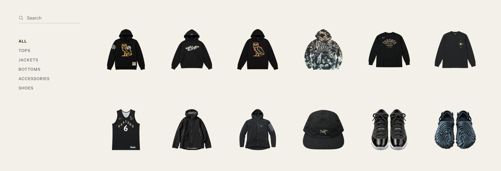
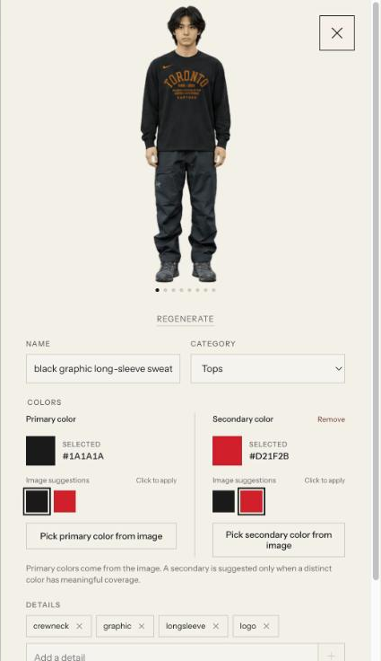

<div align="center">

# Drip

A personal wardrobe gallery. Photograph a piece, get a clean cutout and a 360 spin of it on you.

[](LICENSE)
[](package.json)

</div>





## What it does

- Detects the garment in a photo, looks up the real product name with web search when the brand or design gives it away, and suggests category, colors, and details
- Extracts a clean cutout on a transparent background
- Takes several photos of one piece as angles of the same garment
- Generates an eight view 360 spin of you wearing the piece, with a generic face in place of yours. Drag or use the arrow keys to turn it
- Draws a different reference photo of you from a pool for every generation, so the look varies between pieces and regenerations
- Searches the gallery by name, detail or category with typo tolerance, and keeps the search and category in the URL so a link opens the same view
- Shows visitors a read-only gallery. Editing, importing, regenerating and deleting need the import secret
- Runs locally against a `data/` folder, or on Vercel with a private Blob store so you can import from your phone

## Quick start

```bash
git clone https://github.com/chaodonghu/drip.git
cd drip
npm install
cp .env.example .env
npm run dev
```

Add `OPENAI_API_KEY` to `.env` and put a few full-body photos of yourself in `data/models/`. Different outfits and settings give the generations more variety. A single photo at `data/model-reference.png` also works. The importer stays disabled until a key and at least one photo exist. Then open [localhost:5173](http://localhost:5173).

## Importing

Open the import panel and choose one or more photos.

- One photo imports as one piece.
- Several photos ask whether they are one piece from several angles or separate pieces. One piece takes up to four angles. Remove photos from the selection to get under the limit.
- Each import pauses for review: confirm the crop, then the cutout and its details. The cutout can be regenerated with a note.
- Approving the cutout saves the piece and starts the 360 spin. It takes about a minute and can be regenerated from the item viewer.
- OpenAI refuses to redraw some licensed characters and logos, even on clothing you own. A piece with that artwork fails at the cutout step with a message saying so, and the only option is to remove it from the queue.

Everything lives in `data/` when running locally: `library.json`, originals, jobs, and generated images.

Generation runs on the server. Closing the import panel, or the tab, does not stop it. A step that needs your approval waits until you come back.

## Sharing

Anyone with the URL sees the gallery, the spins and each piece's name, category, colors and details, with nothing to click but Close. Filters live in the URL, so `/?type=shoes&q=pollex` opens that exact view for whoever receives it.

Editing is tied to the import secret. Open the import panel and enter it once, and that browser gets the editor back: name, category and color changes, detail tags, Regenerate on the spin, and Delete. Clear the secret, or get it wrong, and the view returns to read-only.

## Configuration

| Variable | Default |
| --- | --- |
| `OPENAI_API_KEY` | Required |
| `OPENAI_VISION_MODEL` | `gpt-5.4-mini`. Detection and the image tool host |
| `OPENAI_IMAGE_MODEL` | `gpt-image-2`. Cutouts and spins |
| `OPENAI_IMAGE_QUALITY` | `high` |
| `WARDROBE_MODEL_REFERENCE` | `data/model-reference.png`. Fallback when `data/models/` is empty |
| `WARDROBE_DATA_DIR` | `data` |
| `WARDROBE_IMPORT_SECRET` | Unset. Required on Vercel |
| `WARDROBE_STORAGE` | Unset, which uses `data/`. Set `blob` to use Vercel Blob |
| `BLOB_READ_WRITE_TOKEN` | Written to `.env.local` by `vercel env pull` |

Newer OpenAI models work by setting the two model variables. The hosted app runs on `gpt-6.1-sol` and `gpt-image-2.5-sunburst`.

## Deploy to Vercel

The hosted app runs the import API as one Vercel function and keeps the library, import jobs, and your reference photo in a private Vercel Blob store. Anyone with the URL can view the gallery. Creating, approving, regenerating, and deleting items needs the import secret.

`scripts/setup-vercel.sh` runs every step below in one go after `vercel login`. The manual steps follow.

1. Link the project.

   ```bash
   vercel link
   ```

2. Create a private Blob store and connect it to every environment. Connecting the store adds `BLOB_READ_WRITE_TOKEN` to the project.

   ```bash
   vercel blob create-store wardrobe --access private
   ```

3. Add the OpenAI key and an import secret to Production. Add `OPENAI_VISION_MODEL`, `OPENAI_IMAGE_MODEL`, or `OPENAI_IMAGE_QUALITY` the same way to override the defaults.

   ```bash
   vercel env add OPENAI_API_KEY production
   vercel env add WARDROBE_IMPORT_SECRET production
   ```

4. Pull the Blob token into `.env.local`, then upload your model photos and your local library.

   ```bash
   vercel env pull .env.local
   npm run publish-data
   ```

   The script resizes every model photo to 2048 px on the long edge before it uploads. It also replaces the hosted `library.json` with your local copy, so run it before you import from the hosted app, and again after you add or change model photos.

5. Connect the project to the GitHub repo so every merge to `main` deploys to production and every pull request gets a preview URL.

   ```bash
   vercel git connect
   ```

   Without the connection, deploy by hand with `vercel deploy --prod`.

6. Open the deployed app on your phone, open the import panel, and enter the import secret. The browser remembers it, and until it has one the app stays read-only.

Code ships through Git. Data does not: imports made in the hosted app land in Blob directly, and `npm run publish-data` is only needed when you add model photos or import pieces locally and want them hosted. It replaces the hosted library with the local one.

Vercel stops a function after 300 seconds. If a generation step runs out of time, the job shows "Generation timed out. Try regenerating." six minutes after the step started.

## Import with Codex

The repo also bundles two Codex skills. One imports clothes from a folder and generates modeled photos; the other styles complete outfits into a modeled lookbook.

```text
$import-clothes Import the clothes from ~/Pictures/outfits, create modeled photos, and add them to this wardrobe.
$generate-outfits Create modeled outfit ideas from my wardrobe.
```

Open the repo in Codex and run either prompt. The skills live in [`.agents/skills`](.agents/skills) and write to `data/` the same way the app does.

## Credits

Wardrobe started from [tandpfun/wardrobe](https://github.com/tandpfun/wardrobe) by [Thijs Simonian](https://thijs.net), which introduced the detect, cut out, and model pipeline and the gallery design. See [the original post](https://x.com/cdngdev/status/2076812846793650485). This repo keeps that idea and adds Vercel hosting, phone imports, multi-angle pieces, and the 360 spin.

## License

[MIT](LICENSE)
